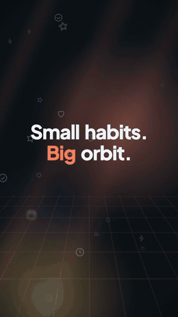

<div align="center">

# marketing-video

**A marketing-video studio for Claude Code.**
Ask for a promo of your website or iOS app — get a professional vertical film, cut to music, in 60 fps.

[Install](docs/INSTALL.md) · [Usage & customization](docs/USAGE.md) · [Storyboard reference](docs/STORYBOARD.md) · [Changelog](CHANGELOG.md)

<a href="docs/media/orbit-showcase.mp4"></a>

<sub>Made with this studio — a fictional app filmed, edited and scored end to end.<br>
<a href="docs/media/orbit-showcase.mp4">Watch the full 60 fps film (29 s, with sound)</a> · reproduce it from <a href="plugins/marketing-video/skills/marketing-video/examples/orbit">examples/orbit</a></sub>

</div>

---

`marketing-video` is a [Claude Code](https://claude.com/claude-code) skill that works like a small production
studio. Claude is the producer, you are the creative director: it checks your toolchain and helps install what is
missing, interviews you, films the **real** product, fills empty screens with honest demo data, writes a storyboard,
splices your music on its bars, renders with [Remotion](https://remotion.dev), checks its own work and delivers
the cuts you need.

```text
/marketing-video a launch video for the new filters in my iOS app — upbeat, 9:16, with 15 s and 30 s cuts
```

## Highlights

| | |
|---|---|
| **Real capture, perfectly smooth** | Websites are filmed frame by frame on a virtual clock (Playwright). iOS apps run in a dedicated Simulator driven by Maestro and are recorded at 60 fps with every tap logged. Recordings from any device can be imported. |
| **Honest demo data** | A local capture proxy rewrites thin or private API data into clearly fictional demo content and answers every write call locally — nothing is written to your servers. Web pages can be injected in the recording browser only. |
| **Motion that explains** | A 3D phone with eased camera moves, zoom-ins on the proving moment, callouts whose arrows point at the exact control, graphic widgets (stat, ring, list), kinetic titles, an animated brand background. |
| **Always in sync** | A callout is on screen only while the app is doing that thing; when a step is too quick to read, the footage pauses for it. |
| **Clean layout** | Fixed zones — title, caption band, phone stage — never overlap; text is optically centred; one phone on screen at a time. |
| **Transitions, not fades** | whip · flip · drop · push · iris · split · carry · flood · hold · cut — each scene grows out of the previous one. |
| **Music & sound** | A Suno prompt generator tuned to your storyboard, or your own track measured and spliced on bars (drop on the first feature, final hit on the logo), or a generated bed. Real recorded SFX on every tap, transition, caption and logo, peak-aligned. Optional voiceover. |
| **Finish & QA** | 240 fps subframes blended to 60 fps (real motion blur), BT.709, −14 LUFS. Automatic checks for layout, timing sync, reading time, safe zones, single-frame pops and colour shifts; one still per bar for review; every render versioned. |
| **Deliverables** | Master, 15/30 s cutdowns, a fast "focus montage" cut, 4:5 and 1:1 crops, App Store preview export. |
| **Remembers you** | Your taste, projects and feedback live in a profile, so every film starts from where the last one ended. |

## Quick start

```bash
git clone https://github.com/ernklyc/marketing-video /tmp/marketing-video
mkdir -p ~/.claude/skills && cp -R /tmp/marketing-video/plugins/marketing-video/skills/marketing-video ~/.claude/skills/
bash ~/.claude/skills/marketing-video/setup.sh
```

Then, in Claude Code, type `/marketing-video` followed by what you want. Not sure your machine is ready? Ask
Claude to *"run the marketing-video doctor"* — it checks every dependency and offers to install what is missing.

Prefer plugins? See [Install → as a plugin](docs/INSTALL.md#option-b--as-a-plugin).

## Requirements

- Claude Code (CLI, desktop app, or IDE extension)
- macOS or Linux · Node.js 20+ · ffmpeg · Python 3 with numpy and Pillow · ~10 GB free disk for rendering
- iOS apps: macOS with Xcode + an iOS Simulator runtime, [Maestro](https://maestro.mobile.dev) and Java 17
- Optional: [Suno](https://suno.com) for music, an ElevenLabs API key for voiceover

## How a film is made

1. **Interview & brief** — channel, length, message, style, pacing, music and deliverables; only what the profile and your product don't already answer.
2. **Inventory & access** — every feature is filmed for real, given demo data, or shown as a truthful motion graphic.
3. **Look** — 2–3 looks from your brand's colours, fonts and logo, shown as stills.
4. **Storyboard & audit** — a beat-timed plan with callouts, widgets and transitions, validated automatically.
5. **Capture** — web, iOS Simulator, or imported recordings.
6. **Preview** — stills around every transition and one per bar.
7. **Sound** — your track spliced on bars, sound design, optional voiceover.
8. **Render, review, deliver** — 60 fps master, QA report, cutdowns and crops on your Desktop.

There's a gate after every stage, and nothing moves on until you've said yes.

## Principles

- Real UI or a truthful motion graphic. Invented *data* is fine and disclosed; invented capabilities, metrics,
  customers or testimonials never.
- Never writes to production, never performs real payments, bookings or messages, never types your passwords.
- Asks before installing software or publishing anything; leaves your repositories clean.

## License

[MIT](LICENSE). Remotion, which is installed during setup, has its own license for company use. See
[THIRD_PARTY_NOTICES.md](THIRD_PARTY_NOTICES.md).
